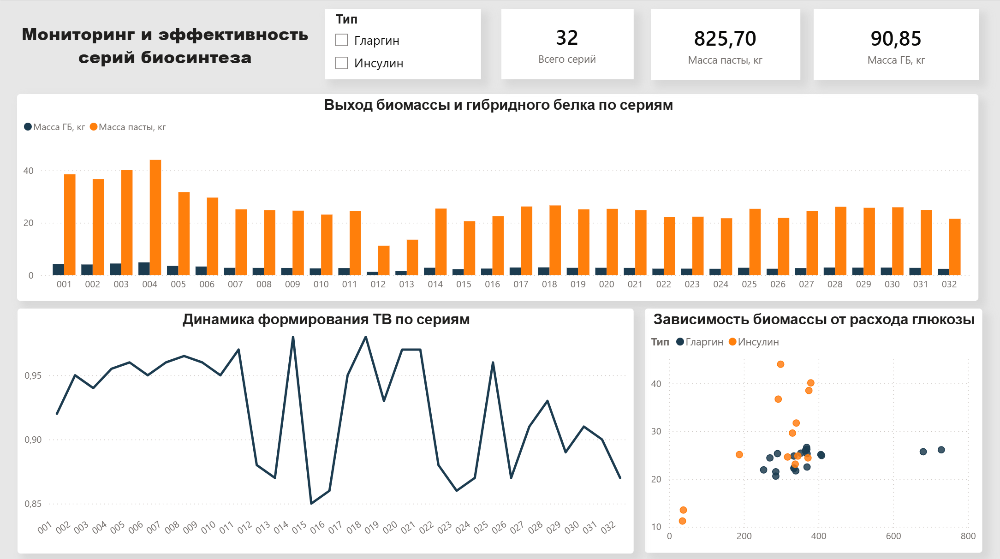
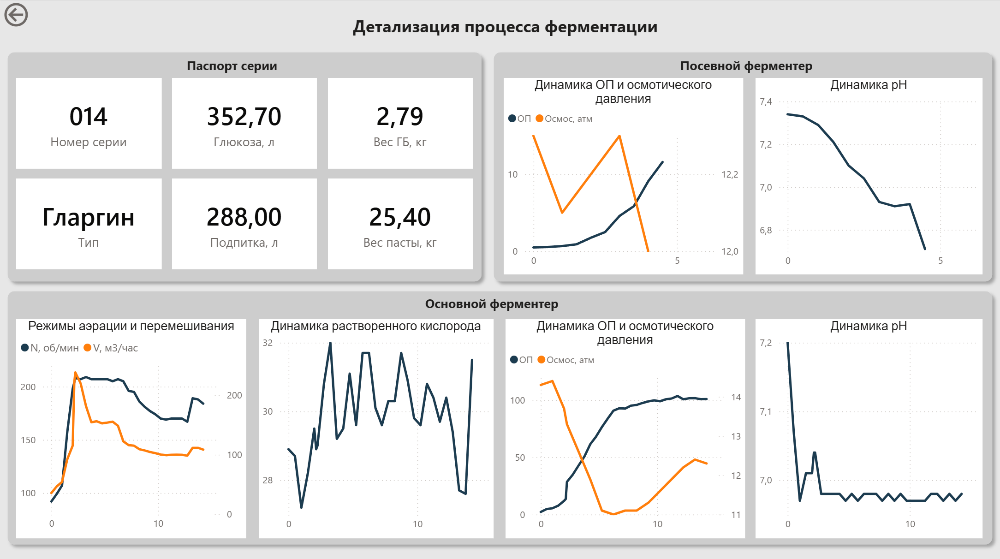

# Автоматизация ETL-пайплайна и SCADA-аналитика процессов биосинтеза (Python + Power BI)

Интегрированное инженерное решение для автоматической обработки сырых данных ферментации (реакторы посевной и основной стадий) и визуализации ключевых показателей эффективности производственных серий (Инсулин / Гларгин).

---

## 📌 Бизнес-контекст и проблематика
На фармацевтическом производстве первичные данные биосинтеза фиксируются в регламентных таблицах Excel, содержащих артефакты мульти-индексов, пропуски датчиков и физические аномалии. 
* **Проблема:** Каждый раз для оценки эффективности наработанных серий и анализа расхода субстратов (глюкозы, подпитки) инженерам и руководству приходится вручную строить графики и сводить данные в Excel, что неудобно и отнимает много времени.
* **Решение:** Построен сквозной аналитический пайплайн, автоматизирующий рутину по очистке и подготовке данных. Созданный Python-скрипт выступает в роли ETL-модуля (валидирует датчики, обрабатывает пропуски, агрегирует телеметрию), а финальный датасет визуализирован в виде SCADA-подобного дашборда в Power BI для начальников цехов и дирекции. Поскольку структура отчетов стандартизирована, скрипт может циклично обрабатывать любые новые файлы.

---

## 🛠 Стек технологий
* **Python** (Pandas, NumPy) — ETL-процесс, очистка временных рядов, валидация диапазонов датчиков, агрегация.
* **Power BI Desktop** (Power Query, DAX) — моделирование данных («Звезда»), проектирование интерфейса.
* **Git / GitHub** — версионирование кода и презентация портфолио.

---

## 📂 Структура проекта
* `data/` — Исходные файлы сырых данных (Excel)
* `notebooks/` — Jupyter Notebook с полным циклом ETL и очистки
* `powerbi/` — Файл дашборда (`insulin_biosynthesis_dashboard.pbix`)
* `screenshots/` — Визуализации дашборда для быстрого просмотра
* `requirements.txt` — Зависимости Python
* `README.md` — Описание проекта

---

## 🚀 Архитектура и этапы обработки данных (Python)
В ноутбуке реализован промышленный пайплайн подготовки данных:
1. **Нормализация шапки:** сжатие двухуровневого мульти-индекса Excel в плоский список с очисткой от служебных меток (`Unnamed`).
2. **Интеллектуальное заполнение пропусков:** применение стратегии `ffill()` для непрерывных параметров (pH, давление, оптическая плотность) и заполнение нулями дискретных дозировок.
3. **Фильтрация аномалий:** программный поиск и замена сбойных показаний датчиков (выбросы по pH, давлению, расходу воздуха выше регламента).
4. **Агрегация (Fact Batch Level):** сводка поминутной телеметрии до уровня отдельных серий с расходом сырья и динамикой фаз.
5. **Интеграция с лабораторией:** мёрдж технологических данных с результатами контроля качества (микроскопия, выход целевого продукта).

---

## 📊 Дашборд в Power BI

### 1. Мониторинг и эффективность серий (Overview)

* **Назначение:** Высокоуровневый мониторинг всех серий биосинтеза с фильтрацией по типу продукта (Инсулин / Гларгин).
* **Метрики:** Общий объем выпуска, суммарный выход биомассы и целевого белка, распределение по партиям.
* **Навигация:** Реализован сквозной переход (`Drill-through`) с любой серии на детальный технологический профиль.

### 2. Детализация процесса ферментации (Detail View)

* **Назначение:** Глубокий технологический анализ конкретной серии (паспорт серии, материальный баланс по субстратам).
* **Мониторинг реакторов:** Посевная стадия (динамика ОП, осмоса, pH) и основная стадия (режимы аэрации N и V, растворенный кислород pO2, часовые профили).

---

## ⚙️ Как запустить проект локально
1. Клонируйте репозиторий с помощью команды в терминале: `git clone https://github.com/Erlychenkoff/biosynthesis-analytics.git`
2. Установите необходимые зависимости для Python-скрипта: `pip install -r requirements.txt`
3. Скачайте файл `insulin_biosynthesis_dashboard.pbix` из папки `powerbi/` и откройте его в Power BI Desktop.
